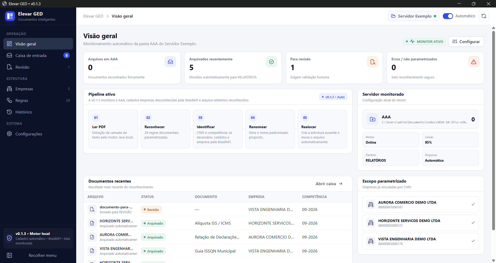

# Elevar GED v0.1.3 — Gestão Eletrônica de Documentos

Evolução da v0.1.2, agora sob a marca **Elevar GED**, da Elevar. **Além do cadastro manual por Cartão CNPJ ou BrasilAPI, o sistema cadastra automaticamente empresas ainda desconhecidas quando recebe um relatório reconhecido na pasta `AAA`.** A integração com a BrasilAPI envia apenas o CNPJ.

## Interface



Demonstração com empresas e documentos fictícios.

## Identidade e compatibilidade

- Nome oficial do produto: **Elevar GED**.
- Versão: **0.1.3**, atualização de identidade e distribuição da v0.1.2.
- Executável: `elevar-ged.jar` (iniciado normalmente por `run.bat` ou `run.sh`).
- Foram preservados o pacote Java `ged`, a propriedade de inicialização `ged.base`, a estrutura de arquivos `config/`, as chaves de configuração e o formato de `companies.json`. Isto evita quebrar instalações anteriores.
- Este pacote não altera as regras de reconhecimento ou a lógica de cadastro e arquivamento da v0.1.2.

## Requisitos

- Java 8 ou mais recente.
- Windows para execução com `run.bat` (ou shell com `run.sh`).
- A pasta raiz indicada em `config/settings.json` deve existir no computador; o Elevar GED nunca cria a raiz.
- **Internet apenas para consultas pela BrasilAPI.** Importação por PDF e arquivamento permanecem locais.
- Não precisa de Maven, Python, Node ou chave de API para rodar o Elevar GED. A compilação do código-fonte exige um JDK.

## Como iniciar

1. Extraia o ZIP em uma pasta com permissão de escrita (não execute o programa dentro do ZIP).
2. Verifique se a raiz do servidor existe. Na configuração distribuída: `C:\Users\adriansantos\Documents\Servidor Exemplo`. Altere na tela **Configurações**, se necessário.
3. Execute `run.bat` no Windows ou `run.sh` em ambientes com shell.
4. Acesse `http://127.0.0.1:8765/` se o navegador não abrir automaticamente.
5. Abra **Empresas** e escolha **Importar Cartão CNPJ** ou **Consultar CNPJ (API)**.


## Cadastro e arquivamento automáticos (novo na v0.1.2)

1. O monitor lê os PDFs depositados na pasta `AAA` e extrai texto localmente com PDFBox.
2. Caso a empresa não exista no cadastro, identifica os CNPJs válidos do **conteúdo do PDF**, sem usar suposições baseadas apenas no nome do arquivo.
3. A automação só prossegue se houver **exatamente um CNPJ válido**, regra documental do tipo `RELATÓRIOS` reconhecida no **texto** (não somente no nome do arquivo), competência no formato `MM-AAAA` e confiança projetada suficiente para o limiar configurado.
4. O Elevar GED consulta `https://brasilapi.com.br/api/cnpj/v1/{cnpj}`; a API de terceiros recebe **somente o CNPJ**, não recebe o PDF ou seu texto. Valida a resposta e cadastra em `config/companies.json` com origem `brasilapi_auto`.
5. Cria a pasta da empresa e refaz o reconhecimento. Se a confiança final passar, cria a estrutura `EMPRESA/AAAA/MM-AAAA/RELATÓRIOS` e move o arquivo; caso contrário, encaminha o documento a `AAA/REVISAO`.
6. Se forem detectados vários CNPJs (por exemplo, prestador e tomador), se a API não responder, se o documento não for reconhecido ou se a confiança for insuficiente, **não cria empresa** e direciona à revisão, com explicação no histórico/diagnóstico.

Essa funcionalidade começa **ativa**, mas pode ser desligada em **Configurações → Cadastrar empresas desconhecidas pela BrasilAPI**. A opção **Criar pastas ausentes** também precisa estar ativada para o cadastro automático. A automação não vale para PDFs digitalizados sem camada de texto, XML, notas fiscais não parametrizadas ou outros tipos de documento ainda fora do escopo. Não é um serviço oficial da Receita Federal.

**Importante:** os CNPJs presentes em documentos de vários participantes não identificam por si só qual é a empresa cliente do escritório; esses arquivos não serão cadastrados automaticamente nesta versão.

## Consulta pela BrasilAPI

1. Clique em **Consultar CNPJ (API)** e digite o CNPJ da empresa.
2. O backend Java valida os dígitos verificadores (inclui formato alfanumérico) e chama `GET https://brasilapi.com.br/api/cnpj/v1/{cnpj}` via HTTPS.
3. A interface apresenta razão social, nome fantasia, situação cadastral, atividade principal, município/UF, opção pelo Simples (se disponível) e a pasta proposta.
4. **Confira** os dados e clique em **Cadastrar empresa**. A consulta sozinha não cria pastas nem salva cadastro.
5. O cadastro é salvo em `config/companies.json` com origem `brasilapi`; a pasta da empresa é criada dentro da raiz, quando necessário.

Para os CNPJs já cadastrados o Elevar GED conserva o vínculo existente sem substituir a pasta nem duplicar o registro. Se a consulta falhar por falta de internet, resposta 404, indisponibilidade ou limite HTTP 429, utilize o Cartão CNPJ em PDF.

**Importante:** BrasilAPI é um projeto de terceiros que consulta dados públicos; não se trata de uma ligação oficial e em tempo real do Elevar GED com a Receita Federal. Confirme as informações cadastrais importantes em fontes oficiais. A indicação de Simples Nacional não comprova Lucro Real ou Lucro Presumido. O Elevar GED não consulta dados privados nem o e-CAC.

## Cadastro pelo Cartão CNPJ

Na tela **Empresas**, clique em **Importar Cartão CNPJ**, escolha o comprovante PDF oficial, revise a prévia e confirme. O cadastro passa pelo mesmo controle de CNPJ duplicado usado na BrasilAPI.

## Política de dados e segurança

- O motor é local e atende em `127.0.0.1` por padrão.
- A pesquisa pela BrasilAPI envia somente o **CNPJ informado** ao serviço externo; o Elevar GED não envia arquivos PDF, documentos da `AAA`, nem seu banco de empresas.
- Os dados do cadastro ficam localmente em `config/companies.json` e são usados no arquivamento automático.
- A confirmação da BrasilAPI usa uma prévia guardada no servidor por até 15 minutos, com token de uso único. O navegador não pode fornecer uma razão social diferente da recebida na consulta.
- O cliente trata timeouts, CNPJ inválido, 404, 429 e indisponibilidade (5xx). Repetir consultas em massa não é recomendado.
- São armazenados somente campos cadastrais necessários; o QSA retornado pela API não é salvo.

## Fluxo automático preservado

A pasta `AAA` continua monitorada, se o monitoramento automático estiver ativado. Apenas PDFs classificados em **RELATÓRIOS**, com empresa cadastrada e competência confiável, são arquivados na estrutura:

```text
RAIZ
├── AAA
│   ├── REVISAO
│   └── ERROS
└── RAZÃO SOCIAL
    └── 2026
        └── 09-2026
            └── RELATÓRIOS
                └── RAZÃO SOCIAL - Documento - 09-2026.pdf
```

Documentos de empresas ainda não cadastradas **podem ser cadastrados e arquivados automaticamente**, desde que atendam aos critérios acima. Os documentos com CNPJ ambíguo, falha na BrasilAPI ou confiança insuficiente vão para `AAA\REVISAO`. Arquivos existentes não são sobrescritos, e o Elevar GED confere a presença de arquivos idênticos no destino.

## Atualização de uma instalação existente

**Faça backup antes de substituir arquivos.** Extraia a v0.1.3 em uma **nova pasta** e, com o Elevar GED antigo fechado, copie da versão em uso (se existirem):

- `config/companies.json` — empresas já cadastradas;
- `config/settings.json` — raiz do servidor e parâmetros existentes;
- `config/rules.json` — apenas se tiver customizações de regras;
- `data/history.jsonl` — histórico, se desejar preservar.

Não copie o `ged-server.jar` antigo nem `assets/app.js` da versão anterior para a v0.1.3. O layout existente de `companies.json` é compatível: novos cadastros recebem o campo `source` e informações opcionais, sem migração obrigatória. Um arquivo `settings.json` antigo também permanece compatível.

## Desenvolvimento e validação

No clone do GitHub, os executáveis e as configurações locais não são versionados. Antes da primeira execução, copie `config/settings.example.json` para `config/settings.json` e `config/companies.example.json` para `config/companies.json`, ajuste a pasta raiz dos documentos e compile o JAR. Preserve configurações já existentes.

Para recompilar o JAR:

```sh
sh build.sh
```

No Windows, utilize `build.bat`.

O teste automatizado (requer JDK e Node para a checagem de sintaxe JavaScript) pode ser executado por `sh tests/run-tests.sh`. Ele usa um **servidor simulado** e não realiza consultas reais a terceiros. Veja `docs/TESTES-v0.1.2.md` e `docs/TESTES-v0.1.3.md`.

## Limitações

- O fluxo documental automático ainda processa apenas PDFs da categoria RELATÓRIOS.
- A API pode responder com dados defasados, não encontrados ou indisponibilidade por excesso de requisições.
- A funcionalidade de cadastro automático foi testada com respostas simuladas e precisa de um teste manual real em ambiente com acesso à BrasilAPI.
- A versão de origem fornecida foi a **v0.0.6**. Não foram incorporadas funcionalidades de uma eventual v0.1.0 que não estivesse nesse pacote.
